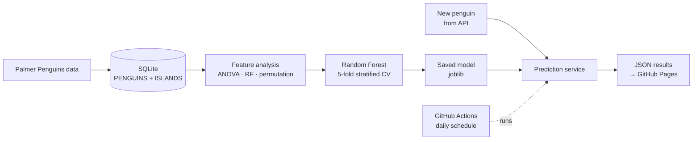
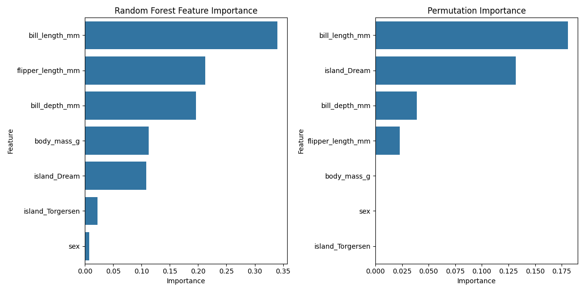

# Penguin Species Classifier: an end-to-end ML pipeline

This is a small but complete machine learning system. It takes raw data, stores it in a database, analyses the features, trains and validates a model, and runs a scheduled prediction service that published its results to a web page.

**Result:** a Random Forest reaches **97.6% ± 1.2% accuracy** in 5-fold stratified cross-validation on 333 penguins from 3 species (Adelie, Chinstrap, Gentoo).

## Pipeline



| Step | Script | What it does |
|---|---|---|
| 1. Data preparation | `scripts/01_data_preparation.py` | Cleans the dataset and stores it in a normalised SQLite database (`PENGUINS`, `ISLANDS`) |
| 2. Feature analysis | `scripts/02_feature_selection.py` | Compares feature relevance with three methods: ANOVA F-test, Random Forest importance and permutation importance |
| 3. Model training | `scripts/03_model_training.py` | Trains a Random Forest, validates it with 5-fold stratified cross-validation and saves the model, scaler and feature list together |
| 4. Prediction service | `scripts/04_prediction_service.py` | Fetches a new penguin's measurements, predicts the species with class probabilities and appends the result to a prediction history |

## Feature importance



All four body measurements carry signal. Bill length and flipper length matter most, so all four were kept.

## Automation

A GitHub Actions workflow (`.github/workflows/predict.yml`) ran the prediction service every morning. It fetched a new penguin from a course API, made a prediction and committed the results to `docs/`, which GitHub Pages published as a small dashboard. It produced 26 automated predictions between March and April 2025.

The course API has since been retired, so the scheduled job is switched off. Steps 1 to 3 still run locally as shown below.

## Run it locally

```bash
git clone https://github.com/Lpiziks2/penguins-classifier.git
cd penguins-classifier
pip install -r requirements.txt

python scripts/01_data_preparation.py
python scripts/02_feature_selection.py
python scripts/03_model_training.py
```

## What I would improve next

- Put the scaler and model in a single scikit-learn `Pipeline` so scaling is fitted inside each cross-validation fold.
- Validate incoming API data, checking for missing values, out-of-range measurements and schema changes, before it reaches the model.
- Check whether the predicted probabilities are well calibrated, not only whether the predicted class is correct.

## Tech stack

Python · pandas · scikit-learn · SQLite · GitHub Actions · GitHub Pages
